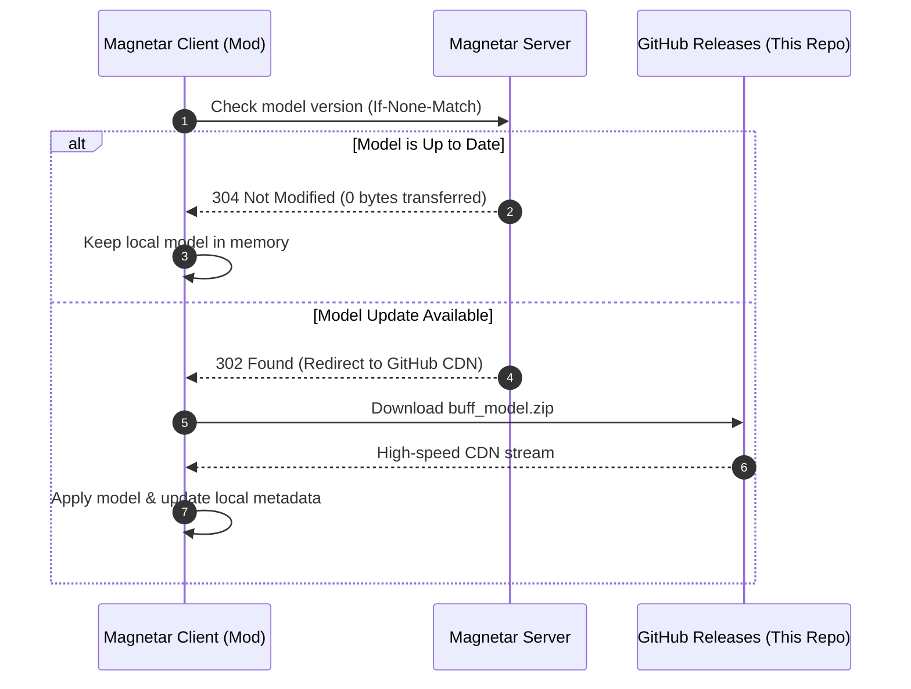

# Magnetar Client Modules

## 📦 What is this Repository?

This repository acts as the public CDN and versioning mirror for assets used by the **Magnetar Client** ecosystem:

## 🔄 How the Sync System Works

